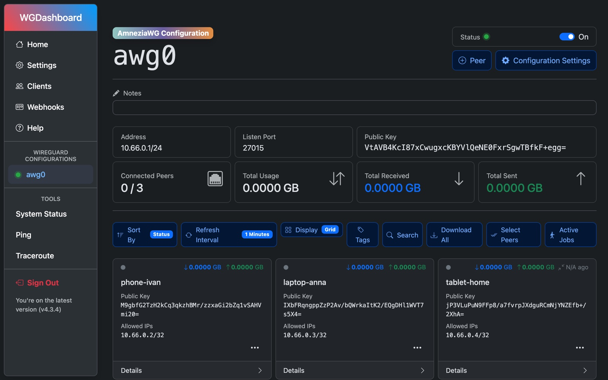

<a id="top"></a>
<div align="center">

# amnezia-quickstart

🇷🇺 **Русский** · 🇬🇧 English (скоро)

[](https://github.com/Avers90/amnezia-quickstart/actions/workflows/check.yml)


[](LICENSE)

Свой VPN-сервер на [AmneziaWG](https://github.com/amnezia-vpn/amneziawg-linux-kernel-module)
с веб-панелью, firewall и своим DNS.<br>
Ansible ставит всё сам, вы правите пару файлов с настройками.



[Свой случай](#case) •
[Быстрый старт](#quickstart) •
[Пароли](#passwords) •
[Инструкция](#docs) •
[Клиенты](#clients) •
[Похожие проекты](#similar)

</div>

> [!IMPORTANT]
> Проект для личного и образовательного использования. Инструменты обхода
> блокировок могут нарушать законы вашей страны: ответственность за
> использование лежит на вас.

## Что получится

- **AmneziaWG**: WireGuard с маскировкой трафика, которую сложнее заблокировать по DPI
- **[WGDashboard](https://github.com/WGDashboard/WGDashboard)**: веб-панель, где вы создаёте клиентов и скачиваете конфиги или QR-коды
- **Firewall** (iptables): открыты только SSH и порт VPN, сканеры портов автоматически банятся
- **[AdGuard Home](https://github.com/AdguardTeam/AdGuardHome)** (по желанию): свой DNS для клиентов VPN с блокировкой рекламы и трекеров
- **Защищённый вход**: отдельный пользователь, только SSH-ключ, root отключён

Всё ставится ролями из [Avers90/ansible-role-*](https://github.com/Avers90?tab=repositories&q=ansible-role).
Проверено на Ubuntu 24.04 (arm64): от 1 vCPU и 1 ГБ RAM без swap.

<a id="case"></a>
## 🎯 Выберите свой случай

| Ситуация | Что сделать |
|---|---|
| Просто нужен VPN | [Быстрый старт](#quickstart) как есть |
| Не нужен свой DNS и блокировка рекламы | `awg_local_dns: false` в `local.yml`, `make dns` не запускать |
| У кого-то старое приложение, не обновить | `make params HOST=vpn1 VERSION=1.0` до создания клиентов ([версии](docs/ru/04-amneziawg-wgdashboard.md#версия-конфига)) |
| Хочется менять IP сервера без перевыпуска конфигов | Домен в `awg_client_endpoint` ([по желанию](docs/ru/04-amneziawg-wgdashboard.md#домен-вместо-ip-по-желанию)) |
| Мобильный оператор режет, Wi-Fi работает | Порт 443 в `Endpoint` клиента ([запасные порты](docs/ru/05-firewall.md#запасные-порты)) |
| У провайдера только пароль root | `make init HOST=vpn1 ASK_PASS=1` |

<a id="quickstart"></a>
## 🚀 Быстрый старт

Нужно: VPS на **Ubuntu 24.04**, компьютер с macOS, Linux или Windows + WSL.
Подробности по каждому шагу в [инструкции](#docs).

```bash
git clone https://github.com/Avers90/amnezia-quickstart.git
cd amnezia-quickstart

make install                # роли и коллекции Ansible
make setup                  # создаёт личные файлы настроек из примеров
```

Заполните три файла (они в `.gitignore`, в git не попадут):

| Файл | Что вписать |
|---|---|
| `ansible/inventory/hosts.yml` | IP сервера |
| `ansible/inventory/group_vars/all/local.yml` | имя пользователя, **публичный** SSH-ключ, нужен ли свой DNS, домен для клиентов — по желанию ([зачем](docs/ru/04-amneziawg-wgdashboard.md#домен-вместо-ip-по-желанию)) |
| `ansible/inventory/group_vars/all/vault.yml` | хеши паролей от `make hash` |

```bash
make hash                   # пароль WGDashboard; второй раз — для AdGuard Home (полный вариант)
make vault-encrypt          # зашифровать vault.yml
make params HOST=vpn1       # уникальные параметры маскировки для этого сервера

make init HOST=vpn1         # базовая система (под root)
ssh vpnadmin@<IP> sudo true # проверить вход под новым пользователем
make ssh HOST=vpn1          # отключить вход под root и по паролю
make vpn HOST=vpn1          # AmneziaWG + firewall + WGDashboard
make dns HOST=vpn1          # AdGuard Home (если нужен свой DNS)

make panel HOST=vpn1        # открыть панель: http://localhost:10086
```

> [!WARNING]
> Не запускайте `make ssh`, пока `ssh vpnadmin@<IP> sudo true` не прошёл без
> пароля: после него root зайти уже не сможет.

<details>
<summary><b>Что меняется на сервере</b></summary>

<br>

| Шаг | Что делает |
|---|---|
| `make init` | `apt upgrade` (по умолчанию с ядром) и перезагрузка, если обновилось ядро; зеркало Ubuntu → `archive.ubuntu.com`; набор утилит (`curl`, `vim`, `jq`, `btop`, `auditd`, `iptables-persistent` и др.); имя хоста, часовой пояс, локаль; приветствие при входе (`/etc/profile.d`); свой `/etc/pam.d/sshd` (оригинал сохраняется); настройки ядра в `/etc/sysctl.d/99-zz-ansible.conf` (BBR, буферы, conntrack, форвардинг); пользователь `admin_user` с ключом и sudo без пароля (`/etc/sudoers.d/<user>`) |
| `make ssh` | новый `/etc/ssh/sshd_config` (оригинал и `sshd_config.d` сохраняются в `*.orig`): вход только по ключу, без root, только `admin_user`, современная криптография |
| `make vpn` | PPA Amnezia и модуль ядра AmneziaWG (DKMS); `/etc/amnezia/amneziawg/awg0.conf` и ключи сервера; сервис `awg-quick@awg0`. Правила iptables и ipset (`/usr/local/sbin/iptables-rules.sh`, сохраняются через `netfilter-persistent`), логи банов в `/var/log/ipset/`. Node.js 22 из NodeSource, WGDashboard в `/opt/WGDashboard`, сервис `wg-dashboard` |
| `make dns` | AdGuard Home в `/opt/AdGuardHome`, сервис `AdGuardHome`; `systemd-resolved` отключается, `/etc/resolv.conf` становится статическим (оригинал сохраняется) |

Повторный запуск ничего не меняет, если вы не меняли настройки. Посмотреть,
что изменится, без применения: добавьте `CHECK=1` к любой команде.

</details>

<a id="passwords"></a>
## 🔐 Пароли

> [!NOTE]
> Пароли для WGDashboard и AdGuard Home задаются заранее: `make hash`
> превращает пароль в хеш, хеш сохраняется в `vault.yml`. После установки
> панели сразу открываются с вашим логином (`admin_user`) и паролем, без
> мастера первого запуска и без `admin/admin`. Можно один пароль на оба, лучше
> разные.

Ansible ничего не спрашивает: vault открывается ключом из `ansible/.vault_pass`,
вход на сервер по SSH-ключу, sudo без пароля. Исключение: `make init
ASK_PASS=1`, если провайдер дал только пароль root.

<a id="docs"></a>
## 📚 Инструкция

1. [Подготовка](docs/ru/01-preparation.md): VPS, SSH-ключ, Ansible
2. [Базовая настройка сервера](docs/ru/02-base-system.md)
3. [Защита SSH](docs/ru/03-ssh.md)
4. [AmneziaWG и WGDashboard](docs/ru/04-amneziawg-wgdashboard.md): параметры маскировки, панель, первый клиент
5. [Firewall](docs/ru/05-firewall.md)
6. [Свой DNS: AdGuard Home](docs/ru/06-adguard-dns.md)
7. [Клиенты](docs/ru/07-clients.md)
8. [Если что-то не работает](docs/ru/08-troubleshooting.md)
9. [Секреты и безопасность репозитория](docs/ru/09-secrets.md)

<a id="clients"></a>
## 📱 Клиенты

Обычный WireGuard не подойдёт: нужен клиент с поддержкой AmneziaWG. По
умолчанию сервер выдаёт конфиги версии **2.0**.

| Приложение | Платформы | Конфиг 2.0 |
|---|---|---|
| [Amnezia VPN](https://amnezia.org) | Windows, macOS, Linux, Android, iOS | с версии 4.8.12.7 |
| [AmneziaWG](https://github.com/amnezia-vpn/amneziawg-windows-client/releases) | Windows | с версии 2.0.0 |
| AmneziaWG | Android, iOS, macOS | актуальная версия из магазина приложений |

> [!TIP]
> Старое приложение с конфигом 2.0 просто не подключится, без понятной
> ошибки. Если обновить его нельзя, выдавайте конфиги версии 1.0
> ([как](docs/ru/04-amneziawg-wgdashboard.md#версия-конфига)). Свежие данные
> по клиентам и их версиям: [таблица в bivlked/amneziawg-installer](https://github.com/bivlked/amneziawg-installer/blob/main/ADVANCED.md#client-gen-adv).

<a id="similar"></a>
## ⚖️ Похожие проекты

| Проект | Как ставит | Кому подходит |
|---|---|---|
| **amnezia-quickstart** (этот) | Ansible с вашего компьютера | Нужны веб-панель, свой DNS, firewall и повторяемая установка на несколько серверов |
| [bivlked/amneziawg-installer](https://github.com/bivlked/amneziawg-installer) | одна bash-команда на сервере | Без панели и без Ansible, управление клиентами из консоли; есть AmneziaWG 3.1 |
| [wg-easy](https://github.com/wg-easy/wg-easy) | Docker + веб-панель | Docker уже стоит; AmneziaWG там экспериментальный |
| [Amnezia VPN](https://amnezia.org) | приложение ставит сервер по SSH | Без терминала, всё мышкой |

**Когда этот проект не лучший выбор:** не хочется ставить Ansible на свой
компьютер или нужен AmneziaWG 3.1 — посмотрите bivlked/amneziawg-installer.

<details>
<summary><b>Структура репозитория</b></summary>

```
Makefile                    все команды: make help
ansible/
  inventory/
    hosts.yml.example       → hosts.yml          (ваш сервер)
    group_vars/all/
      main.yml              общие настройки (пользователь, sudo, ssh)
      local.yml.example     → local.yml          (ваши личные настройки)
      vault.yml.example     → vault.yml          (пароли, шифруется)
    group_vars/awg/main.yml настройки VPN, firewall, панели, DNS
    host_vars/<host>/awg.yml параметры маскировки (make params)
  playbooks/                init, ssh, vpn, firewall, dns
  requirements.yml          роли, закреплённые на конкретных коммитах
scripts/
  gen-awg-params.py         генератор параметров маскировки
  hash-password.sh          bcrypt-хеш пароля
  check-secrets.sh          защита от коммита личных данных
docs/ru/                    инструкция
```

</details>

---

<div align="center">

[MIT](LICENSE) · [Наверх ↑](#top)

<sub>Проект не связан с Amnezia, WGDashboard, AdGuard и WireGuard.<br>
«WireGuard» — зарегистрированный товарный знак Jason A. Donenfeld.</sub>

</div>
