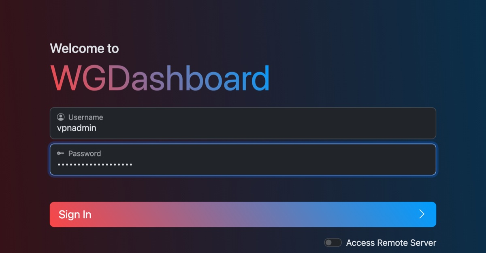
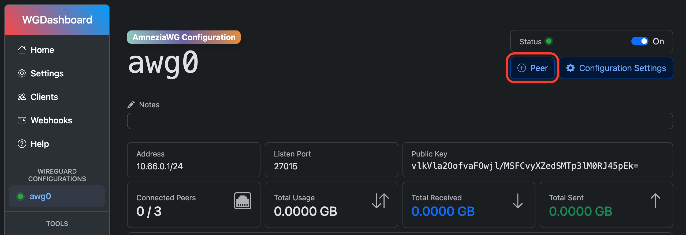
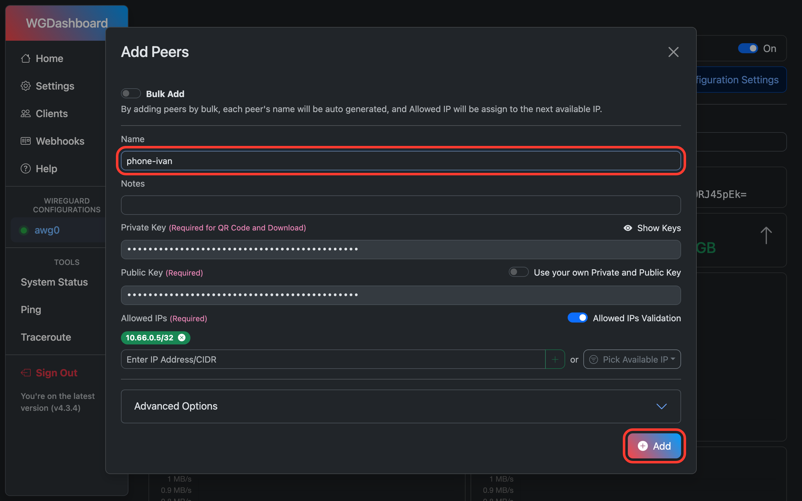
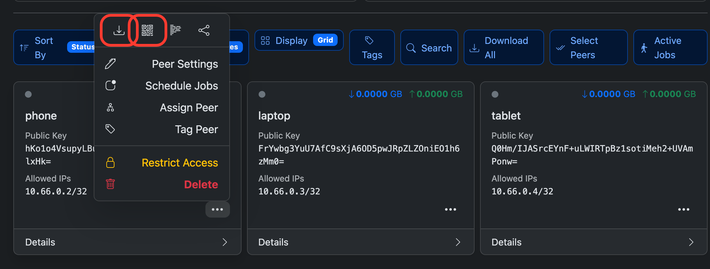
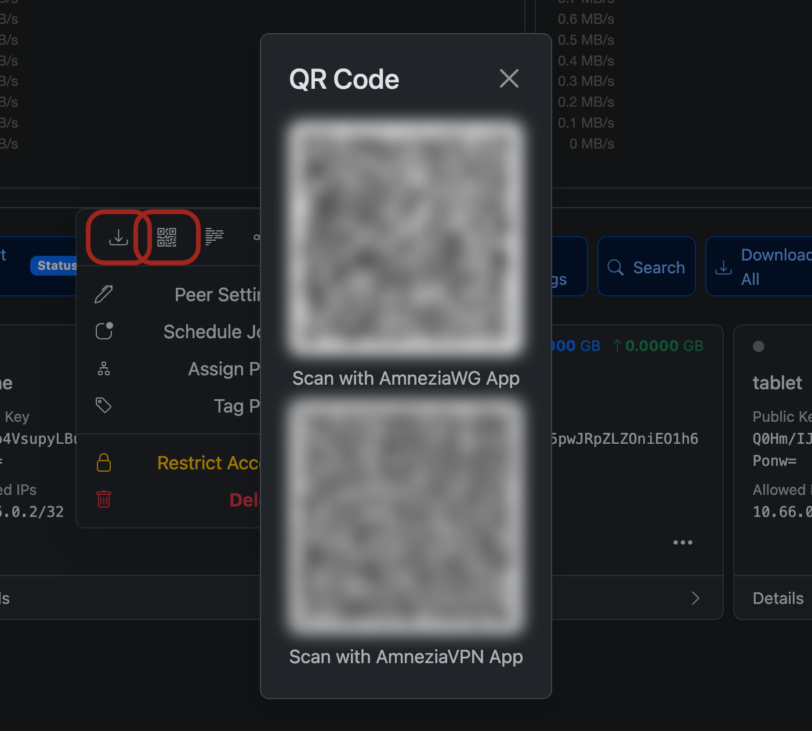

# 4. AmneziaWG и WGDashboard

## Параметры маскировки

AmneziaWG отличается от WireGuard набором параметров (`Jc`, `S1`…`S4`,
`H1`…`H4`, `I1`), которые меняют вид пакетов. Сервер и клиент должны знать
одни и те же значения: они попадают в конфиг клиента.

**У каждого сервера свои параметры.** Если взять значения из примеров в
интернете или дефолты роли, ваш сервер будет выглядеть так же, как тысячи
других, и одна сигнатура DPI заблокирует всех сразу.

```bash
make params HOST=vpn1
```

Создаётся `ansible/inventory/host_vars/vpn1/awg.yml` со случайными
значениями. Скрипт проверяет ограничения протокола и не выдаёт двум вашим
серверам одинаковые `H1`–`H4` и `I1`.

### Версия конфига

По умолчанию `2.0`. Менять нужно, только если у кого-то старое приложение,
которое нельзя обновить.

<details>
<summary><b>Чем отличаются версии и как выбрать другую</b></summary>

<br>

| Версия | Что добавляет | Клиент |
|---|---|---|
| `2.0` (по умолчанию) | `S3`, `S4`, `I1` | Amnezia VPN с 4.8.12.7, AmneziaWG для Windows с 2.0.0, актуальные AmneziaWG для Android, iOS, macOS |
| `1.5` | `I1` (пакет перед handshake, похожий на DNS-ответ) | с поддержкой `I1` |
| `1.0` | только `Jc`, `S1`, `S2`, `H1`–`H4` | любой клиент AmneziaWG |

```bash
make params HOST=vpn1 VERSION=1.0
```

</details>

> [!TIP]
> Старый клиент с конфигом новой версии не подключается и не показывает
> ошибку. Если у кого-то «просто не работает», проверьте версию приложения.

### Параметры менять нельзя

> [!WARNING]
> После создания первого клиента параметры фиксированы: при их смене все
> выданные конфиги перестанут работать. Поэтому `make params` не
> перезаписывает существующий файл.

<details>
<summary><b>Если сменить всё же нужно</b> (например, перейти на <code>VERSION=1.0</code>, пока клиентов мало)</summary>

<br>

1. Удалите **всех** клиентов в панели. Пока на сервере есть хоть один
   клиент, Ansible не перезапишет конфиг AmneziaWG и только напишет
   `WARNING: [Interface] params differ ... but N peer(s) exist`
2. Удалите `ansible/inventory/host_vars/vpn1/awg.yml`
3. `make params HOST=vpn1` (с нужным `VERSION=`) и `make vpn HOST=vpn1`.
   Панель перезапустится сама и начнёт выдавать конфиги с новыми
   параметрами
4. Создайте клиентов заново и раздайте новые конфиги

</details>

## Пароль панели

```bash
make hash
```

Введите пароль (от 12 символов). Скрипт выведет строку, которая начинается
с `$2` (например, `$2y$12$...` или `$2b$12$...`, подходят обе). Вставьте её в
`vault.yml`:

```yaml
vault_wgdashboard_pass_hash: "$2y$12$..."
```

Сам пароль нигде не сохраняется, запомните его или положите в менеджер
паролей. Логин в панель равен `admin_user`.

Когда заполнены оба хеша (второй для AdGuard Home, раздел 6), зашифруйте
файл:

```bash
make vault-encrypt
make vault-view     # посмотреть
make vault-edit     # изменить
```

## Домен вместо IP (по желанию)

По умолчанию в конфиги клиентов (строка `Endpoint`) пишется IP сервера.
Это работает, ничего настраивать не нужно.

> [!TIP]
> Домен вместо IP — дополнительная возможность. Она пригодится, если IP
> придётся сменить: тогда клиентам не нужно перевыпускать конфиги. Если
> домена нет или это лишние хлопоты, пропустите раздел.

Решить лучше до создания первого клиента: домен попадает только в конфиги,
скачанные после настройки.

### Зачем

IP вписывается в конфиг один раз, при скачивании, и дальше живёт на
устройстве пользователя. Если IP сменится, каждому придётся скачать новый
конфиг. Сменить IP приходится чаще, чем кажется:

- **IP заблокировали.** У некоторых операторов блокируют отдельные IP или
  целые подсети хостеров. Лечится покупкой нового IP или переездом
- **Переезд на другой VPS** (дешевле, быстрее, провайдер закрылся). Ключи и
  клиенты переносятся, а IP меняется всегда
- **Провайдер сам поменял IP** при миграции

С доменом в любом из этих случаев достаточно поменять одну A-запись.
Клиенты переподключаются (выключить и включить VPN) и попадают на новый адрес.
Ничего не нужно перевыпускать и рассылать.

### Как настроить

1. Нужен свой домен (подойдёт самый дешёвый) и DNS-хостинг: у регистратора
   или в Cloudflare (бесплатно)
2. Создайте A-запись, например `node1.example.com` → IP сервера, TTL 300
   (5 минут: смена IP разойдётся быстро)
3. **Cloudflare: только DNS, без проксирования** (серое облако, «DNS only»).
   Прокси Cloudflare пропускает только HTTP(S), UDP через него не пройдёт, и
   VPN не подключится. Обычные DNS-хостинги ничего не проксируют, там этот
   шаг не нужен
4. В `local.yml`:

   ```yaml
   awg_client_endpoint: "node1.example.com"
   ```

5. `make vpn HOST=vpn1`. Все конфиги, скачанные после этого, будут с
   доменом

Проверка: `dig +short node1.example.com` показывает IP сервера.

### На что обратить внимание

- **Имя без слова «vpn».** Домен виден в DNS-запросе при каждом подключении,
  нейтральное имя (`node1`, `cdn2`, `mail`) привлекает меньше внимания
- **Старые конфиги не меняются.** Домен попадёт только в конфиги, скачанные
  после настройки. У тех, кто скачал раньше, остался IP, им нужно скачать
  конфиг заново (один раз)
- **Сервер по-прежнему подключается по IP.** Ansible и SSH ходят на
  `ansible_host` из `hosts.yml`, домен нужен только клиентам
- Клиент узнаёт IP по домену в момент включения VPN. Если IP поменялся, пока
  VPN включён, его нужно переподключить
- Если домен не настроен, всё работает и с IP. Просто смена IP обойдётся
  дороже

## Установка

```bash
make vpn HOST=vpn1
```

Порядок:

1. **AmneziaWG**: модуль ядра из PPA Amnezia, ключи сервера, интерфейс `awg0`
   с адресом `10.66.0.1/24`
2. **Firewall**: правила iptables и NAT, подробности в [разделе 5](05-firewall.md)
3. **WGDashboard**: на сервере ставится Node.js и собирается интерфейс

> [!NOTE]
> Сборка интерфейса панели идёт 5–10 минут без вывода. Так и должно быть,
> не прерывайте.

Перед установкой плейбук проверяет, что параметры маскировки свои, а не
дефолтные, и что хеш пароля задан.

## Панель

WGDashboard слушает только `127.0.0.1` на сервере, из интернета её не видно.
Открывается через SSH-туннель:

```bash
make panel HOST=vpn1
```

Пока команда работает, панель доступна на <http://localhost:10086>. Закрыть
туннель: `Ctrl+C`.

Логин равен `admin_user`, пароль тот, из которого вы делали `make hash`:



## Первый клиент

> [!IMPORTANT]
> Если `awg_local_dns: true`, сначала поставьте AdGuard Home
> ([раздел 6](06-adguard-dns.md)), иначе у клиентов не будет работать DNS.

> [!NOTE]
> Скриншоты сняты на тестовом стенде: ключи, адреса и QR-коды на них
> одноразовые и ни к чему не подключаются.

**1.** Слева в разделе *WireGuard Configurations* откройте `awg0` и нажмите
**Peer**:



**2.** Впишите имя клиента, например `phone-ivan`, и нажмите **Add**.
Остальное заполнится само: ключи, адрес из `10.66.0.0/24`, а в
*Advanced Options* — DNS, MTU 1376 и keepalive. Менять ничего не нужно.



**3.** Внизу страницы появится карточка клиента. Нажмите на `•••`. Первые две
иконки в меню: **скачать конфиг** (`.conf`) и **показать QR-код**:



**4.** QR-кодов два: верхний для приложения **AmneziaWG**, нижний для
**AmneziaVPN**. Сканируйте тот, который подходит к приложению на устройстве:



> [!CAUTION]
> QR-код и `.conf` содержат приватный ключ клиента. Не публикуйте их и не
> отправляйте в открытые чаты, подробнее в [разделе 7](07-clients.md#как-передавать-конфиг).

Один клиент — одно устройство. Если с одним конфигом одновременно работают
два устройства, они будут выбивать друг друга.

## Основные настройки

`ansible/inventory/group_vars/awg/main.yml`:

| Переменная | По умолчанию | Что это |
|---|---|---|
| `amneziawg_address` | `10.66.0.1/24` | сеть туннеля, до 253 клиентов |
| `amneziawg_port` | `27015` | порт UDP, на который подключаются клиенты |
| `wgdashboard_peer_mtu` | `1376` | MTU в конфигах клиентов |
| `wgdashboard_peer_keep_alive` | `25` | keepalive, держит соединение за NAT |

`local.yml`:

| Переменная | Что это |
|---|---|
| `awg_client_endpoint` | по желанию: доменное имя вместо IP в конфигах клиентов, см. [выше](#домен-вместо-ip-по-желанию) |

Сеть туннеля и порт выбираются до создания клиентов, потом их не меняют.

Дальше: [5. Firewall](05-firewall.md)
